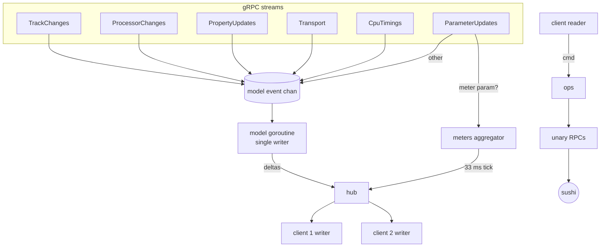
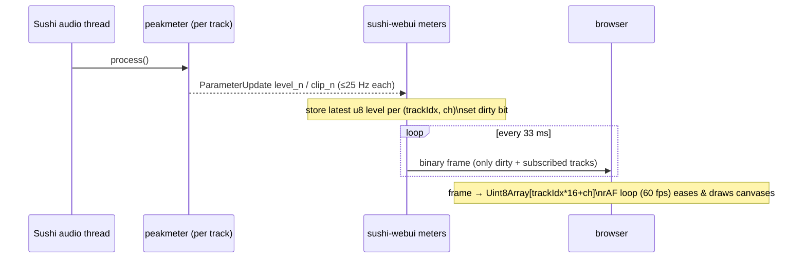

# Sushi WebUI — Technical Architecture

Status: **draft for review** · Target Sushi API: `sushi_rpc` 1.2.0 (`rpc_interface/protos/sushi_rpc.proto`)

## 1. Goals and constraints

| # | Requirement | Consequence |
|---|-------------|-------------|
| G1 | Control Sushi from any browser on the LAN (desktop, tablet, phone) | Browser cannot speak native gRPC/HTTP2 trailers → a backend bridge is mandatory |
| G2 | Fast VU meters on low-end phones | Meters bypass the UI framework; binary frames; one `requestAnimationFrame` loop on canvas |
| G3 | Track-centric workflow: Mixer → Track → Plugin | Backend adds track "kind" (audio/MIDI), per-track meters, solo — none exist in Sushi |
| G4 | Run on Elk Audio OS (Yocto, RPi4, read-only rootfs, RT kernel) | No Node on target; single static binary, no runtime deps, low CPU, never steal RT time |
| G5 | Multiple simultaneous clients (e.g. tablet + phone) | Backend owns a state mirror and fans out deltas; all clients stay consistent |

Non-goals for v1: undo/redo, automation recording, plugin native GUIs, remote (internet) access, multi-Sushi control.

## 2. System overview

```mermaid
flowchart LR
  subgraph Device["Device (macOS dev box or Elk RPi4)"]
    S["sushi\n(gRPC :51051)"]
    W["sushi-webui (Go)\nHTTP + WS :8080\nembedded static UI"]
    FS[("~/.config/sushi-webui\nprojects/*.sushiproj\nplugins.json")]
    PL[("/usr/lib/lv2, ~/.vst3 …")]
    W -- "unary RPCs\n+ 6 server streams" --> S
    W --- FS
    W -. "scan" .-> PL
  end
  B1["Desktop browser"] -- "WS: JSON + binary meters" --> W
  B2["Tablet"] -- WS --> W
  B3["Phone"] -- WS --> W
```



Two processes on the device: **sushi** (unchanged) and **sushi-webui**, a single Go binary that is gRPC client, state mirror, WebSocket hub, and static file server. Browsers only ever talk to sushi-webui.

### Why Go
- Cross-compiles to `linux/arm64` with `CGO_ENABLED=0`: one ~15 MB static binary, no interpreter, nothing to add to the Yocto image (an OE recipe using `go-mod.bbclass` is trivial later; or ship the prebuilt binary).
- First-class gRPC (`google.golang.org/grpc`), cheap goroutines for the streams, predictable low memory (~20–30 MB RSS).
- Node (scraporchestra) is not on Elk images and needs manual installation on a remounted rootfs; Python (sushi-gui/elkpy) is available but web-framework packages are not, and the GIL makes meter fan-out less predictable.

### Why Svelte + TypeScript
- Compiles to small vanilla JS (runtime ≈ a few kB), fine-grained updates without a virtual DOM — good for phones.
- Built on the dev machine with Vite; only static assets (HTML/JS/CSS) are embedded into the Go binary via `embed.FS`. **Node is a dev-time dependency only.**

## 3. Sushi API facts the design depends on

Verified against this repo:

| Fact | Source | Design impact |
|------|--------|---------------|
| `TrackType` = REGULAR / PRE / POST only | proto `TrackType` | "Audio" vs "MIDI" track is WebUI metadata |
| `ProcessorInfo{id,label,name,parameter_count,program_count}` — no uid/path/type | proto `ProcessorInfo` | Backend keeps a processor registry (uid, type, role) |
| No plugin enumeration RPC | — | Backend plugin catalog (§5.4) |
| Track params `gain` (dB −120..+24), `pan` (−1..1, only when channels ≤ 2), `mute`; multibus adds `gain_sub_N`, `pan_sub_N` | `src/engine/track.cpp:235-268` | Mixer strip controls; tracks addressed as processors in ParameterController |
| No level parameters on tracks | `track.cpp` | Auto-insert hidden `sushi.testing.peakmeter` as last processor |
| Track gain/pan/mute applied **after** the processor chain | `track.cpp:154-192, 380` | Peakmeter is pre-fader → backend adds fader/pan gain to get post-fader meters (§4.8) |
| Peakmeter outputs `level_0..15` (dB −120..+24), `clip_0..15`; controls `link_channels`, `peaks_only`, `update_rate` (/s, default 25) | `src/plugins/peak_meter_plugin.cpp:28-90` | Meter source |
| Parameter notifications throttled to 1 per param per 40 ms | `event_dispatcher.cpp`, `MAX_PARAMETER_UPDATE_INTERVAL` | Meters ≤ 25 Hz from Sushi; UI interpolates to 60 fps |
| `SetParameterValue` takes normalized 0..1 (clamped) | `parameter_controller.cpp:214` | UI works in normalized space; displays `formatted_value` |
| `ParameterUpdate{parameter, normalized_value, domain_value, formatted_value}` | proto | No scaling logic re-implemented in UI |
| Parameter subscription = blocklist only | `grpc_async_service_call_data.h:206-249` | Backend subscribes once to everything, filters per client |
| CPU timings streamed every 1 s | `TIMING_UPDATE_INTERVAL` | CPU indicator in top bar |
| Graph mutations are async; completion visible via `ProcessorUpdate`/`TrackUpdate` notifications | proto `NotificationController` | Backend awaits notifications with timeout instead of sleeping (sushi-gui anti-pattern) |
| `SaveSession`/`RestoreSession` full snapshot; tracks/processors referenced by name | proto `SessionState` | Project files = SessionState + WebUI sidecar, keyed by names |
| Default gRPC `[::]:51051`, `--grpc-address` | `include/sushi/options.h:52-56,460` | Backend flag `--sushi=localhost:51051` |

## 4. Backend design (Go)

### 4.1 Package layout

```
cmd/sushi-webui/main.go        flags, wiring, signal handling
internal/sushi/                generated stubs (protoc-gen-go, -go-grpc) + Client wrapper
internal/sushi/supervisor.go   connect, version check, streams, backoff, resync
internal/model/                authoritative state mirror + change events
internal/meta/                 WebUI metadata (track kind, color, order, meter ids, solo, macros)
internal/catalog/              plugin catalog (internal list + LV2/VST3 scan + plugins.json)
internal/ops/                  high-level graph operations (AddTrack, AddPlugin, Solo, …)
internal/meters/               meter aggregation + binary frame encoder
internal/hub/                  WebSocket sessions, subscriptions, command dispatch
internal/project/              save/load/list projects
web/                           Svelte app (built into web/dist, embedded)
```

Dependencies: `google.golang.org/grpc`, `google.golang.org/protobuf`, `github.com/coder/websocket` (formerly nhooyr.io/websocket). Standard library for everything else (`net/http`, `encoding/json`, `log/slog`, `embed`).

### 4.2 Concurrency model



- **Single-writer model**: one goroutine owns `model.State`; everything else sends events. No locks on hot paths.
- **Meter fast path**: parameter updates whose `(processor_id, parameter_id)` is a known meter output go straight to the aggregator (a fixed array of latest values per track/channel) and never touch the model or JSON.
- **Per-client writer goroutine** with a bounded queue. Slow client policy: meter frames are *dropped* (only latest matters), JSON deltas are queued; if the queue overflows the client is sent a fresh `snapshot` and the queue cleared.

### 4.3 Supervisor and resync
1. Dial Sushi (`--sushi`, default `localhost:51051`), `GetSushiApiVersion` → refuse unknown major versions, warn on minor mismatch.
2. Open the six notification streams (blocklist empty).
3. Build full state: `GetAllTracks`, per track `GetTrackProcessors`, `GetTrackParameters`, for each processor `GetProcessorParameters`, `GetParameterValue`/`AsString` (batched with bounded concurrency, e.g. 8), `GetProcessorPrograms`, `GetProcessorBypassState`, transport getters, routing getters.
4. Reconcile metadata: match tracks by **name** with `meta` (ids change across Sushi restarts); detect existing peakmeters (processor name `__meter__<track>`) or insert them.
5. Push `snapshot` to all clients.
On stream error: mark `connection=lost`, notify clients, exponential backoff (0.5 s → 5 s), repeat from 1. Notifications arriving during step 3 are buffered and applied after.

### 4.4 Model (state mirror)

```go
type State struct {
    Rev        uint64               // bumps on every delta
    Tracks     []TrackID            // display order (from meta)
    TrackByID  map[TrackID]*Track
    Procs      map[ProcID]*Processor
    Params     map[ParamKey]*Param  // ParamKey{Proc, Param}
    Transport  Transport
    Cpu        CpuLoad
    Sushi      SushiInfo            // version, channel counts, samplerate
}
type Track struct {
    ID TrackID; Name, Label string; Type TrackType // REGULAR/PRE/POST
    Kind TrackKind  // AUDIO | MIDI (meta)
    Channels, Buses int
    Chain []ProcID  // user-visible processors only, in order
    MeterProc ProcID // hidden
    Color string; Solo bool; MutedByUser bool
    Inputs, Outputs []AudioConnection; MidiIn *KbdConnection
}
type Processor struct {
    ID ProcID; Name, Label string; Track TrackID
    UID, Path string; Type PluginType; Role Role // from registry/catalog
    Bypassed bool; Program int; Programs []Program
    Params []ParamKey; Properties []PropKey; Macros []ParamKey
}
type Param struct {
    Key ParamKey; Name, Label, Unit string; Kind ParamKind // BOOL/INT/FLOAT
    Automatable bool; Min, Max float32
    Norm float32; Domain float32; Text string
}
```

### 4.5 Metadata sidecar (`meta`)
Persisted as JSON next to each project and as `current.meta.json` for the running session. Keyed by **names** (stable across Sushi restarts), not ids.

```json
{
  "version": 1,
  "tracks": {
    "Guitar": { "kind": "audio", "color": "#d9a441", "order": 0, "solo": false,
                "macros": { "Drive": ["drive", "tone", "level"] } },
    "Synth":  { "kind": "midi",  "color": "#5aa0d8", "order": 1 }
  },
  "processors": {
    "Drive": { "uid": "sushi.brickworks.drive", "type": "internal", "role": "audio_fx" }
  }
}
```

The processor registry is also seeded from `SaveSession` (each `TrackState.processors[]` carries `uid`, `path`, `type`), so tracks created outside the WebUI (e.g. from a Sushi JSON config) still get uid/role information. Roles for unknown plugins default to `audio_fx`.

### 4.6 Graph operations (`ops`)
All ops are serialized through a single op queue (prevents interleaved graph edits from two clients) and each returns a `result` to the requesting client. Completion is detected by awaiting the matching notification with a 3 s timeout.

| Op | Sushi calls |
|----|-------------|
| **AddAudioTrack**(name, channels 1/2, inputs[], outputs[]) | `CreateTrack{name, channels}` → await `TRACK_ADDED` → `ConnectInputChannelToTrack` × n → `ConnectOutputChannelFromTrack` × n → `CreateProcessorOnTrack{uid: sushi.testing.peakmeter, name: __meter__<name>, add_to_back}` → set `update_rate` to max |
| **AddMidiTrack**(name, midi port/channel, instrument uid, outputs[]) | `CreateTrack{channels: 2}` → `ConnectKbdInputToTrack{track, channel, port, raw_midi:false}` → outputs → peakmeter → optional `CreateProcessorOnTrack(instrument)` before meter |
| **AddPlugin**(track, uid, type, path, section, index) | `CreateProcessorOnTrack{…, position{add_to_back:false, before_processor: <next visible proc or meter>}}` |
| **MovePlugin**(proc, index) | `MoveProcessorOnTrack{processor, source_track, dest_track, position}` (validated against section rules) |
| **RemovePlugin** | `DeleteProcessorFromTrack` |
| **RemoveTrack** | `DeleteProcessorFromTrack` for each (incl. meter) → `DeleteTrack` |
| **SetParam**(key, norm) | `SetParameterValue` (coalesced, see 4.7) |
| **SetBypass / SetProgram** | `SetProcessorBypassState` / `SetProcessorProgram` |
| **Solo**(track, on) | compute effective mutes: soloed set non-empty ⇒ every non-soloed track `mute=1`; else restore `MutedByUser`. Writes via `SetParameterValue` on track `mute`. Sushi's `mute` therefore = `MutedByUser OR (soloActive AND !Solo)` |
| **Transport** | `SetTempo`, `SetPlayingMode`, `SetSyncMode`, `SetTimeSignature` |
| **SaveProject / LoadProject** | `SaveSession` → write `.sushiproj`; `RestoreSession` → resync |

**Section rules (MIDI tracks)**: chain = `[midi_fx…] [instrument (0..1)] [audio_fx…]`. Rule enforced in UI and validated in `ops` using processor roles. Audio tracks: `[audio_fx…]` only (instruments and MIDI fx rejected).

### 4.7 Parameter write path and echo handling
- Client sends `set` messages as fast as the pointer moves; the client itself throttles to one per animation frame per param.
- Backend coalescer: per `ParamKey` keep the latest value; a 10 ms ticker flushes pending writes as `SetParameterValue` (bounded concurrency). This bounds gRPC traffic regardless of client count.
- Sushi notifies the change back (≤ 25 Hz). The model updates and the hub fans out `param` deltas to **all** subscribed clients, tagged with `src: <clientId>` when the most recent write to that param came from that client within 250 ms. The originating client ignores tagged deltas *for a param it is currently dragging*; when the gesture ends it applies the last server value (authoritative). This avoids the fragile "ignore for 400 ms" timer used in scraporchestra.

### 4.8 Meter pipeline



- **Pre-fader correction.** `Track::process_audio` (`src/engine/track.cpp:154-192`) runs the plugin chain first and applies gain/pan/mute afterwards (`_apply_pan_and_gain`, using `calc_l_r_gain`). A peakmeter in the chain therefore measures **pre-fader** level. The backend derives the displayed post-fader level: `level_post[ch] = level_pre[ch] + 20·log10(chGain(gain, pan, ch))`, and −∞ when muted. Mono tracks are duplicated to both channels, as Sushi does. This is exact for the static case (Sushi's smoothing ramps last a few ms). The UI can toggle each meter between PRE and POST. Upstream alternative (open question): add `level_*` output parameters to `Track` in Sushi itself.
- Level quantization: dB value clamped to display range −60…+6 dB, mapped to 0…255 (≈0.26 dB resolution). Values below −60 dB → 0.
- Peakmeter `peaks_only` stays **false** (we want continuous level for ballistics); smoothing/peak-hold/decay (e.g. 20 dB/s fall, 1.5 s hold) is done in the browser.
- Bandwidth: 16 stereo tracks × 30 fps × (32 entries × 5 B + 3 B) ≈ 5 KB/s per client. Fine on any LAN.
- CPU on Sushi side: one more parameter stream source; peakmeter cost is negligible. The meter can be disabled per track by bypassing it if CPU is critical.

### 4.9 Plugin catalog
1. **Internal** (always present, uids in `src/plugins`): grouped with roles:
   - instrument: `sushi.testing.sampleplayer`, `sushi.brickworks.simple_synth`
   - midi_fx: `sushi.testing.arpeggiator`, `sushi.testing.transposer`, `sushi.testing.step_sequencer`
   - audio_fx: `sushi.testing.{gain, equalizer, freeverb, sample_delay, mono_summing, stereo_mixer, send, return}`, `sushi.brickworks.{bitcrusher, cab_sim, chorus, clip, comb_delay, compressor, dist, drive, eq3band, flanger, fuzz, highpass, multi_filter, noise_gate, notch, phaser, ring_mod, saturation, tremolo, vibrato, wah}`
   - hidden/utility (not offered by default): `peakmeter, passthrough, lfo, cv_to_control, control_to_cv, wav_streamer, wav_writer`
2. **LV2**: scan `LV2_PATH` or `/usr/lib/lv2:/usr/local/lib/lv2:~/.lv2`; read each bundle's `manifest.ttl` + plugin `.ttl` with a minimal line-based Turtle reader to extract URI, `doap:name`, and `a lv2:InstrumentPlugin` / `lv2:MIDIPlugin` for role. No librdf/lilv dependency.
3. **VST3**: scan `/usr/lib/vst3`, `/usr/local/lib/vst3`, `~/.vst3` (and `/Library/Audio/Plug-Ins/VST3` on macOS) for `*.vst3` bundles; read `Contents/Resources/moduleinfo.json` when present for class names/subcategories (`Instrument` → role). Otherwise name from bundle, role `audio_fx`, editable.
4. **VST2**: only via `plugins.json` (no reliable metadata without loading).
5. **`plugins.json` override** (in config dir): add/rename/hide entries, set roles, curated favourites. Same spirit as sushi-gui's `installed_plugins_target.json`.

Catalog entry: `{id, name, vendor, uid, path, type: internal|lv2|vst3|vst2, role, tags[]}`.

### 4.10 Projects
A project = `projects/<name>.sushiproj/` directory containing `session.pb` (serialized `SessionState`) and `meta.json`. Load: `RestoreSession` → full resync → apply meta by names. Also support "import Sushi JSON config" later (read-only conversion) — out of scope for v1.

## 5. Browser ↔ backend protocol

Single WebSocket at `/ws`. Text frames are JSON; binary frames are meters. Every message has `t` (type). Protocol version negotiated in `hello`.

### 5.1 Server → client

```jsonc
{"t":"hello","proto":1,"server":"0.1.0","sushi":{"version":"1.4.0","api":"1.2.0","inputs":8,"outputs":8,"samplerate":48000}}
{"t":"snapshot","rev":812,"state":{ /* model.State as JSON, minus meter values */ },"catalog":[…],"projects":[…]}
{"t":"delta","rev":813,"ops":[
   {"op":"param","k":[12,3],"n":0.62,"txt":"-4.2 dB","src":"c7"},
   {"op":"track+","track":{…}}, {"op":"track-","id":5},
   {"op":"proc+","proc":{…},"track":3,"index":2}, {"op":"proc-","id":19},
   {"op":"chain","track":3,"chain":[17,21,19]},
   {"op":"bypass","id":17,"v":true}, {"op":"program","id":17,"v":4,"name":"Warm Pad"},
   {"op":"transport","tempo":120,"playing":"PLAYING"},
   {"op":"cpu","avg":0.23,"max":0.41},
   {"op":"conn","sushi":"ok"|"lost"}
]}
{"t":"result","id":42,"ok":true,"data":{…}} | {"t":"result","id":42,"ok":false,"error":"NOT_FOUND","msg":"…"}
```
If a client sees a `rev` gap it requests `{"t":"resync"}`.

### 5.2 Client → server

```jsonc
{"t":"sub","meters":"all"|[3,5],"params":[17]}       // view-based subscriptions
{"t":"set","k":[12,3],"n":0.62}                        // fire-and-forget, coalesced
{"t":"cmd","id":42,"op":"addTrack","args":{"kind":"midi","name":"Synth","midiPort":0,"midiChannel":"omni","instrument":"sushi.brickworks.simple_synth","outputs":[[0,0],[1,1]]}}
{"t":"cmd","id":43,"op":"addPlugin","args":{"track":3,"catalogId":"int:sushi.brickworks.drive","section":"audio_fx","index":1}}
// other ops: movePlugin, removePlugin, removeTrack, renameTrack, setTrackColor, reorderTracks,
//            solo, setBypass, setProgram, setMacros, setTransport, saveProject, loadProject, refreshCatalog
```

**Subscription semantics**: track-level params (gain/pan/mute) and graph/transport/cpu deltas go to every client. Plugin parameter deltas go only to clients whose `params` list contains that processor (the Track view subscribes to the macro params of all its processors; the Plugin view subscribes to one processor fully). Meters only for the listed tracks. This keeps a phone looking at one plugin cheap.

### 5.3 Binary meter frame

```
offset size  field
0      1     type = 0x01
1      2     seq (u16 LE, wraps)
3      2     count N (u16 LE)
5      5*N   entries: trackIdx u16 LE | ch u8 | level u8 (0..255 ↔ −60..+6 dB) | flags u8 (bit0 = clip)
```
`trackIdx` is the position in `snapshot.state.tracks` (master/post track = 0xFFFF). Indices are re-sent in every snapshot.

## 6. Frontend design (Svelte 5 + TypeScript)

### 6.1 Structure
```
web/src/
  lib/net/socket.ts         WS connect/reconnect (backoff), hello/snapshot/delta, rev tracking
  lib/net/meters.ts         binary decode → shared Uint8Array levels[512], clips[512]
  lib/state/*.svelte.ts     runes-based stores: graph, params, transport, catalog, connection, ui
  lib/render/meterLoop.ts   single rAF loop; registry of visible meter canvases
  lib/widgets/              Knob, Fader, PanKnob, Toggle, Stepper, ProgramSelect, Meter, FocusSlider
  routes/Mixer.svelte  Track.svelte  Plugin.svelte
  sheets/AddTrack.svelte PluginBrowser.svelte Projects.svelte
  app.css                   design tokens (CSS custom properties), breakpoints
```
Routing: hash-based (`#/mixer`, `#/track/:name`, `#/track/:name/plugin/:proc`) — works from the embedded file server without server-side routes and survives reloads. Routes use **names**, not ids (stable across Sushi restarts).

### 6.2 State and reactivity
- `params` is a `Map<string, ParamState>` of `$state` objects; deltas mutate fields in place so only widgets bound to that param re-render.
- Graph deltas (rare) replace small arrays (`chain`, `tracks`) — cheap.
- No global re-render on parameter changes; no reactivity at all for meters.

### 6.3 Meter rendering (the hot path)
- `meters.ts` writes incoming values into `Float32Array target[]` (dB from u8).
- `meterLoop.ts` runs one `requestAnimationFrame` for the whole app:
  - per visible meter: `display += (target - display) * attack|release` (fast attack, ~20 dB/s release), peak-hold 1.5 s, clip latch until tapped.
  - draws with `fillRect` on a per-meter `<canvas>` sized with `devicePixelRatio`; gradient pre-rendered once into an offscreen canvas and blitted with `drawImage` (cheapest path on mobile GPUs).
  - meters register/unregister on mount/unmount; an `IntersectionObserver` flags off-screen meters which are skipped.
  - when no meter changed for 2 s (silence) the loop sleeps until the next frame arrives.
- Alternative considered: one big canvas overlay for all meters (fewer canvases); keep as optimization if profiling on RPi-hosted pages shows canvas count is a problem.

### 6.4 Widgets (touch-first, Pointer Events)
| Widget | Interaction | Notes |
|--------|-------------|-------|
| Knob | vertical (or circular) relative drag; 200 px = full range; Shift / second finger = fine ×0.1; double-tap = default; wheel on desktop; arrow keys | SVG arc, 44 px min target, value bubble while dragging |
| Fader | relative drag (no jump-to-touch), dB taper visual scale; double-tap = 0 dB | vertical on desktop/tablet, horizontal on phone portrait |
| PanKnob | bipolar knob, centre detent (snap within ±2 %) | |
| Toggle | tap | mute/solo/bypass/BOOL params |
| Stepper | −/+ buttons and drag | INT params, shows `formatted_value` |
| ProgramSelect | prev/next + searchable list sheet | uses `GetProcessorPrograms` |
| FocusSlider | full-width overlay on phone, large precise slider + numeric readout | opened by tapping a knob on phone |
- All widgets use `setPointerCapture`, `touch-action: none` on the control only (page still scrolls elsewhere), and `aria-valuenow`/`role=slider` for accessibility.
- Gesture conflict rule: on scrollable containers, a drag must move > 6 px in the control's axis before it is captured, otherwise the page scrolls.

### 6.5 Responsive layout
Breakpoints: **phone** < 600 px, **tablet** 600–1023 px, **desktop** ≥ 1024 px. Orientation-aware on phone (landscape phone uses tablet mixer strips). See `UX_DESIGN.md`.

### 6.6 Resilience
- WS reconnect with backoff; UI greyed with a "Reconnecting…" bar; on reconnect a new snapshot replaces state, current route kept if the named track/plugin still exists.
- Sushi lost (backend up, Sushi down): banner "Sushi engine not running" and controls disabled.
- Commands show a pending state (spinner on the slot) until `result`; errors shown as a toast with Sushi's status text.

## 7. Performance budget
| Metric | Target |
|--------|--------|
| Backend CPU on RPi4 with 16 tracks + 2 clients | < 3 % of one core |
| Backend RSS | < 40 MB |
| Frontend JS gzip | < 80 kB |
| Meter rendering, 16 stereo tracks, mid-range phone | 60 fps, < 4 ms per frame |
| Param latency (touch → audible) on LAN | < 30 ms |

## 8. Build and deployment

### 8.1 Dev
```
cd web && npm i && npm run dev            # Vite on :5173 (proxy /ws → :8080)
go run ./cmd/sushi-webui --sushi localhost:51051 --dev
```
`make proto` regenerates stubs from a vendored copy of `sushi_rpc.proto` (pinned to the Sushi release; CI compares it with Sushi's repo).

### 8.2 Release
```
make web                                   # vite build → web/dist
GOOS=linux GOARCH=arm64 CGO_ENABLED=0 go build -trimpath -ldflags="-s -w" -o dist/sushi-webui ./cmd/sushi-webui
```

### 8.3 Elk Audio OS
- Install to `/udata/sushi-webui/` (persistent data partition, no rootfs remount needed) or via a Yocto recipe into `/usr/bin` later.
- Config/projects in `/udata/sushi-webui/` (`--data-dir`).
- systemd unit (pattern from scraporchestra):
```ini
[Unit]
Description=Sushi WebUI
After=sushi.service network-online.target
Wants=network-online.target

[Service]
User=mind
ExecStart=/udata/sushi-webui/sushi-webui --listen :8080 --sushi localhost:51051 --data-dir /udata/sushi-webui
Restart=on-failure
Nice=10
CPUAffinity=0
# keep off the cores Sushi's RT threads use

[Install]
WantedBy=multi-user.target
```
- Runs at normal priority, pinned away from the audio cores. No RT privileges needed.

### 8.4 CLI flags
`--listen :8080`, `--sushi localhost:51051`, `--data-dir`, `--plugin-path` (repeatable), `--auth user:pass` (optional basic auth), `--dev`, `--log-level`.

## 9. Security
LAN-only tool. Binds to all interfaces by default (needed for phones) with optional HTTP basic auth and an `Origin` check on the WebSocket upgrade. No TLS by default (document reverse proxy option). File-path properties (e.g. sample player) are restricted to `--data-dir/samples` and plugin paths.

## 10. Testing strategy
- Go: unit tests for model reducer, solo logic, section rules, meter encoder; integration tests against a real `sushi --dummy` (or `--offline`) started in CI with `--grpc-address`.
- Fake Sushi: a Go gRPC fake implementing the subset of services, for deterministic tests and for running the UI without audio hardware.
- Frontend: Vitest for stores/protocol; Playwright for flows at 3 viewport sizes; a meter stress page (64 tracks) for fps profiling.

## 11. Risks and open questions
1. **Meter ids**: peakmeter is a regular processor and appears in other tools (sushi-gui) and in saved sessions — acceptable; name prefix `__meter__` lets us hide it consistently.
2. **Solo emulation** writes `mute` on other tracks — a third-party client changing mute concurrently could fight with it. Mitigation: the backend recomputes from `MutedByUser` on every external mute change.
3. **Multibus tracks** created outside the WebUI: show per-bus gain/pan in Track view, single meter pair per bus (peakmeter sees all channels).
4. **Pre/Post tracks**: shown as "Input" and "Master" strips; master meter = peakmeter on the post track (created on demand if `CreatePostTrack` is allowed at runtime — to verify).
5. **Plugin parameter counts** (large VST3s with 1000+ params): virtualized list + lazy value fetch on first view.
6. Sushi notifications for `MoveProcessorOnTrack` arrive as remove+add — chain order must be re-read with `GetTrackProcessors` after moves (to verify).
